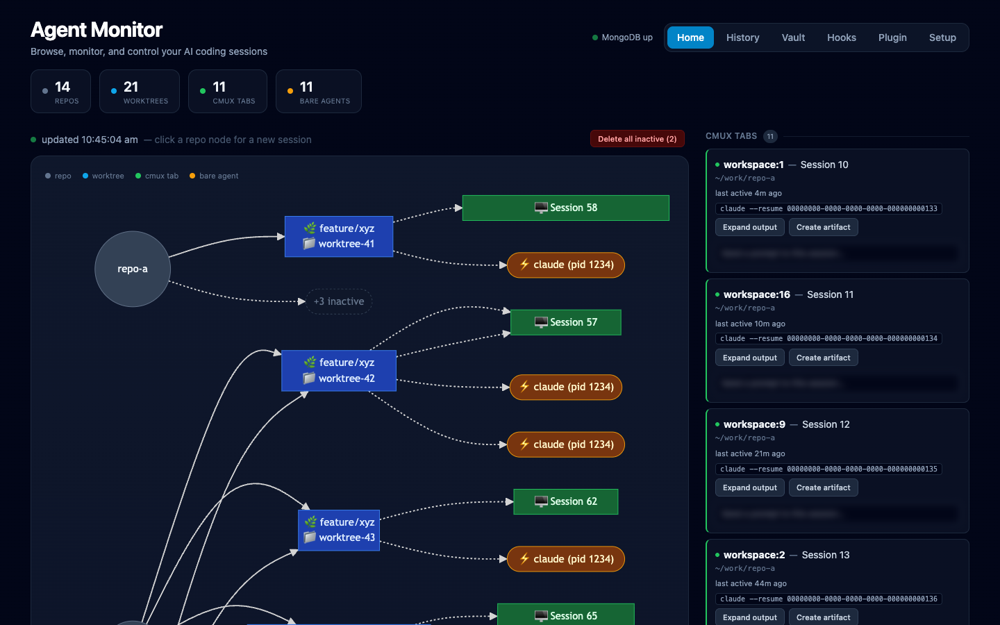
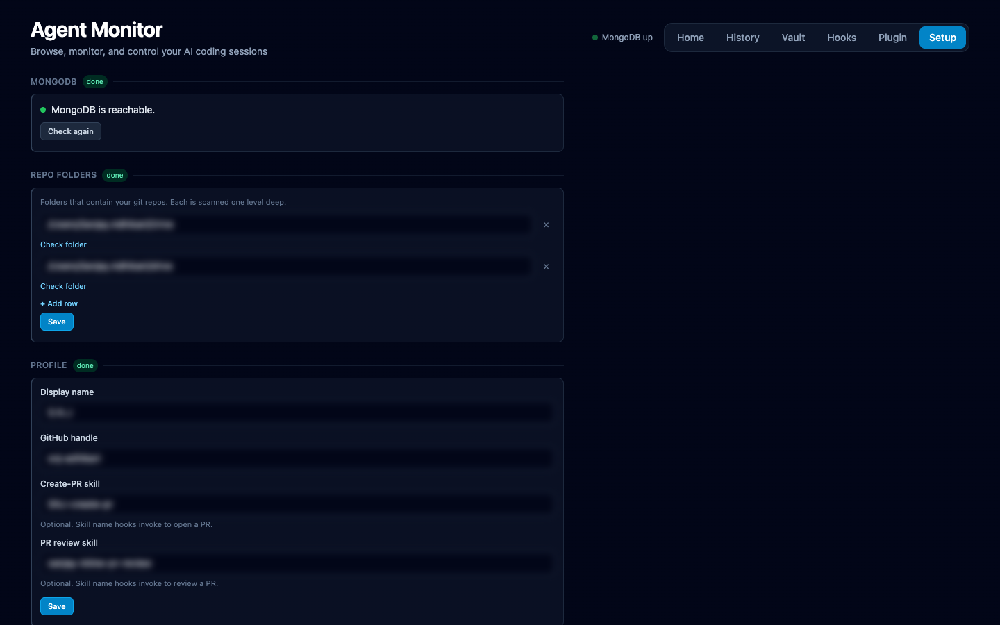
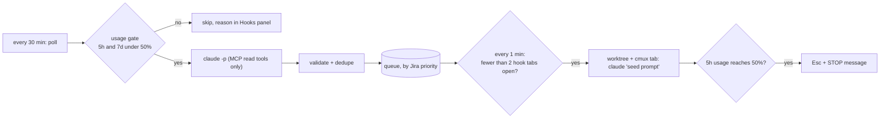
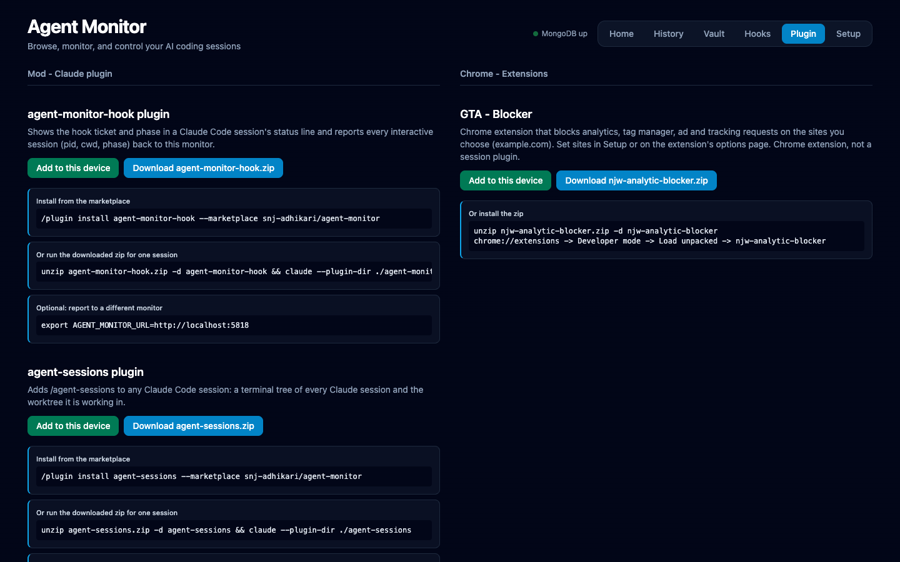

# agent-dashboard

Live dashboard of git worktrees, cmux tabs, and bare agent CLI processes (Claude Code, Copilot, Codex, etc.) across the repo folders you configure.



## Structure

```
src/                     Node/TS server
  index.ts                 entrypoint: HTTP server + routing + static serving of web/dist
  http.ts                   small res/req helpers
  types.ts                  shared types
  utils.ts                  sh/sanitize/timeAgo helpers
  services/
    repos.ts                 git worktree discovery, changed-file count, PR lookup, removal
    cmux.ts                   cmux workspace listing (+ Claude session-id resolution)
    cmuxControl.ts            send prompt / read screen for a workspace
    processes.ts              bare agent process discovery, session-id extraction, termination
    newSession.ts             create a new worktree + cmux session
    state.ts                  aggregates repos/tabs/agents
    mermaid.ts                renders the graph
    db.ts                     MongoDB connection
    history.ts                periodic snapshot logging + range queries
  routes/                   one file per API route

web/                     Vite + React + TypeScript + Tailwind v4 frontend
  src/App.tsx               nav (Home/History) + polling
  src/components/           StatBar, MermaidGraph, TabList, AgentList, WorktreeList,
                             NewSessionModal, HistoryPage, Card
  src/api.ts                typed fetch wrappers
  src/types.ts               shared types (mirrors src/types.ts)
```

## Quick start

```bash
git clone https://github.com/snj-adhikari/agent-dashboard.git
cd agent-dashboard
npm install
npm run build   # web/ (Vite/React/Tailwind), then the server (tsc)
echo 'MONGO_URL=mongodb://127.0.0.1:27017' > .env   # optional, this is the default
npm start       # serves web/dist + the API on :5818
```

The server prints the Setup URL (e.g. `Setup incomplete: open http://localhost:5818/setup`) while setup is incomplete or MongoDB is unreachable. Open http://localhost:5818: on first run a welcome guide walks through MongoDB, repo folders, profile, vault, Atlassian and hooks, the LaunchAgent with cmux socket access, and the Chrome blocker. Re-run it any time from the **Setup** page. `npm run dev` builds and starts in one go.

## Setup



Each step saves on its own; later steps stay locked until MongoDB is up.

1. **MongoDB**: reachability check with install steps (`brew install mongodb-community`, `brew services start`). History and all settings need it.
2. **Repo folders**: directories scanned one level deep for git repos. "Check folder" counts the repos found.
3. **Profile**: display name, GitHub handle, and optional skill names hooks use to open or review a PR.
4. **Vault** (optional): path to a notes folder. The Vault page is hidden when unset.
5. **Atlassian + hooks**: Atlassian site, Repository custom field, work-item types, subtask type, project-to-repo mappings, base-branch rules, usage-state file.
6. **LaunchAgent**: generates a plist from a label (default `agent-monitor`), installs it with `launchctl bootstrap` and can remove it. Only env var names are stored in MongoDB, never values; regenerating with the same label keeps existing secrets.
7. **Blocker sites**: domains the Chrome extension blocks analytics on (see below).

Settings live in the MongoDB `settings` collection. Env vars override them:

- `MONITOR_PORT` (default `5818`)
- `MONGO_URL` (default `mongodb://127.0.0.1:27017`), `MONGO_DB`
- `WATCH_DIRS`: comma-separated repo folders, e.g. `WATCH_DIRS=~/code,~/projects`; replaces the saved list
- `VAULT_PATH`: notes folder
- `DISABLE_HOOKS=1`: no hook polling
- `CLAUDE_BIN`: path to the `claude` binary
- `MONGO_SERVICE`: Homebrew service name the Setup guide starts

### Migrating an existing install

`npm run settings:import -- <flags>` (builds, then runs the script) imports a `hooks.config.json` and LaunchAgent plist into the settings collection (names only from the plist):

```bash
npm run settings:import -- \
  --repo-dirs ~/code,~/projects --vault ~/notes \
  --plist ~/Library/LaunchAgents/agent-monitor.plist \
  --hooks-config ./hooks.config.json \
  --display-name "Your Name" --github your-handle \
  --create-pr-skill my-create-pr --pr-review-skill my-pr-review \
  --atlassian-site https://example.atlassian.net --repository-field customfield_10000 \
  --work-types "Bug,Dev subtask" --subtask-type "Dev subtask" \
  --usage-state ~/.claude/usage-state.json \
  --blocker-sites example.com --blocker-name "GTA - Blocker" \
  --extra-instructions-file ./extra.txt
```

Set `MONGO_DB=<db>` to seed a copy first. Every flag is optional.

## Develop

```bash
npm run build   # rebuild after changes
npm start
```

## Run in the background

Run it detached so it survives closing the terminal:

```bash
nohup npm start > /tmp/agent-monitor.log 2>&1 &
echo $! > /tmp/agent-monitor.pid
```

Check it's up: `curl -s http://localhost:5818/api/graph | head -c 100`

Stop it: `kill $(cat /tmp/agent-monitor.pid)`

Or use `pm2` if you already run other background Node processes that way:

```bash
pm2 start dist/index.js --name agent-monitor
pm2 save   # persist across reboots (with `pm2 startup` run once)
```

### cmux tabs (when running as a LaunchAgent / outside a cmux surface)

`cmux workspace list` is how the dashboard reads cmux tabs, but the cmux CLI refuses connections
from anything that isn't a child process of cmux itself (`socketControlMode: cmuxOnly`, the
default) — so a standalone LaunchAgent always sees "0 cmux tabs" even when tabs are open. It also
needs `cmux`/`git`/`gh` on `PATH`, which a LaunchAgent's default `PATH`
(`/usr/bin:/bin:/usr/sbin:/sbin`) doesn't include.

The **Setup** page (Background service step, "cmux socket access") does this for you: it generates a token, shows the cmux settings snippet to copy, and writes the same token into the plist as `CMUX_SOCKET_PASSWORD`. The token is never stored in MongoDB. To do it by hand instead (one-time):

1. In `~/.config/cmux/cmux.json`, back up the file first, then add an **uncommented** block:
   ```jsonc
   {
     "automation": {
       "socketControlMode": "password",
       "socketPassword": "<a random token, e.g. `python3 -c \"import secrets; print(secrets.token_hex(24))\"`>"
     }
   }
   ```
   Then `cmux reload-config`.
2. In the LaunchAgent plist (`~/Library/LaunchAgents/<label>.plist`, label `agent-monitor` by default; the Setup guide generates it), add:
   ```xml
   <key>EnvironmentVariables</key>
   <dict>
       <key>PATH</key>
       <string>/opt/homebrew/bin:/opt/homebrew/sbin:/usr/local/bin:/Applications/cmux.app/Contents/Resources/bin:/usr/bin:/bin:/usr/sbin:/sbin</string>
       <key>CMUX_SOCKET_PASSWORD</key>
       <string><same token as above></string>
   </dict>
   ```
3. Reload the agent (a plain `launchctl kickstart` does **not** pick up plist env changes):
   ```bash
   launchctl bootout gui/$(id -u)/<label>
   launchctl bootstrap gui/$(id -u) ~/Library/LaunchAgents/<label>.plist
   ```

`password` mode is the least-privileged option that still allows an external process to connect —
prefer it over `allowAll`/`openAccess`/`full`.

### MongoDB (for History)

History logging needs a local MongoDB reachable at `mongodb://127.0.0.1:27017` (override with `MONGO_URL`):

```bash
brew tap mongodb/brew
brew install mongodb-community
brew services start mongodb/brew/mongodb-community   # runs as a background service, persists across reboots
```

Without it, `/api/history` returns an error but the rest of the dashboard works fine.

## API

- `GET /api/graph?expanded=<repoId,...>` — mermaid graph + structured state (repos/worktrees/tabs/agents)
- `POST /api/terminate {pid}` — SIGTERM a bare agent process
- `POST /api/remove-worktree {path}` — `git worktree remove`
- `POST /api/remove-worktrees {paths}` — bulk remove, per-path results
- `POST /api/send {ref, text}` — send a prompt into a cmux workspace
- `GET /api/screen?ref=` — read a cmux workspace's current terminal output
- `POST /api/new-session {repoPath, branch}` — create a worktree + open a cmux tab running `claude`
- `GET /api/history?range=day|week|month` — activity timeline + session summaries from MongoDB
- `GET /api/hook-status` — per-hook poll/gate/error state, recent starts, queue
- `POST /api/hooks/jira/start {key}` — start one ticket now

## Features

- Click a repo node on the graph to spawn a new worktree + cmux session (modal)
- Inactive worktrees collapse into a "+N inactive" node per repo; click to expand
- Deleting inactive worktrees keeps any with an open cmux tab or agent, an open PR, or files changed in the last hour; a merged or closed PR (or a branch behind the default branch) makes one inactive, and with no PR it is inactive after 5 days without file changes
- Per-worktree changed-file count and open-PR badge (real `git status` / `gh pr list`, no fabricated metrics)
- Multi-select worktree deletion, per-repo "clear all"
- Per-tab: expand live terminal output, send a prompt, "create artifact" quick action
- Claude session-id extraction (`claude --resume <id>`) for any running `claude` process, cmux tab or bare
- History page: MongoDB-backed activity timeline (day/week/month) + session list

## Known limitations

- Token usage / cost / "efficiency" per session is not exposed anywhere we can read from outside the session — the dashboard never fabricates these.
- "Switch to session" in History only works while the cmux tab is still open; cmux workspace refs die when a tab closes, so closed sessions are read-only history.
- cmux tabs need the cmux daemon reachable at its socket; if it's down, the dashboard degrades gracefully to showing bare agent processes only.

## Automation hooks

A tiny registry of `Trigger`s (`{ name, poll() }`) in `src/services/hooks/` auto-starts work when a Jira ticket is assigned to you or someone asks for a PR review in Slack.



- **jira**: tickets assigned to the current Jira user in the last 35 min (`assignee CHANGED TO currentUser()` or created), not Done, of type `Bug` / `Defect subtask` / `Dev subtask`, or a `Task` with "spike" in the summary. Stories never auto-start.
  - Work tickets get branch `fix/<key>`. Claude implements, runs build/tests, then either waits for your approval (`completion: "approve"`, the default) or commits, pushes and opens a **draft** PR (`"draft-pr"`).
  - Spikes get branch `tech/<key>` and are investigated read-only. Findings are published as a visual Artifact (diagrams/charts) and written to the notes vault. No PR.
  - Branch collisions get `-i` / `-ii` suffixes. The base is `origin/HEAD` unless a `baseBranches` rule matches (e.g. tickets for one project branch from `origin/release`).
- **slack-pr-review**: "pr review please" plus a GitHub PR link, mentioning you or in a DM, from the last 35 min. It opens a tab in that repo's main checkout running `/pr-reviewer-inline-comments <link>`, which only drafts a pending review.
- **Manual start**: type a ticket key (e.g. `PROJ-123`) into the Hooks panel. This bypasses the lookback window, queue and usage gate; it is still deduped.
- Add a third hook by writing one `Trigger` file and adding it to the `HOOKS` array.

**Guardrails**
- Polls run `claude -p --tools "" --allowedTools <read-only MCP tools>` with a JSON schema. Built-in tools are removed, so any other tool (including MCP writes) is auto-refused because headless mode can't prompt. Your normal `~/.claude` config, skills and MCP servers are otherwise untouched.
- Ticket and Slack text never reaches the work session. The seed prompt carries only the validated ticket key or PR URL, and tells Claude to fetch the ticket itself and treat its content as untrusted data.
- Keys, types, PR URLs (optional `allowedGithubOrgs`) and timestamps are validated in code. Repos come only from explicit config mappings, never from fuzzy matching on titles.
- The server binds to `127.0.0.1` and rejects foreign `Host`/`Origin` headers and non-JSON POSTs (blocks LAN access, CSRF and DNS rebinding).
- A locked 1Password vault (for any `op read` fallback) opens an `op signin` tab and skips that cycle.
- Hook tabs are titled `[hook:<name>] <branch>`. They are normal cmux tabs and worktrees in the dashboard; closing a tab frees its slot for the next queued ticket.

**Config**: copy `hooks.config.example.json` to `hooks.config.json` (gitignored, re-read every cycle). It holds the project and Repository-field → repo mappings, base-branch rules, `completion`, `maxConcurrent` and `pollModel`. State (seen ids, queue, halted tabs) lives in `hooks-state.json`.

**Cost**: each poll is a real `claude -p` run that loads your full context, about $0.3–1 per poll on Sonnet 5 (measured). That's 2 hooks × 48 polls a day while the gate is open. Change `pollModel`, or remove a hook from `HOOKS`, to cut it.

**Mod**: `mods/agent-monitor-hook` shows the hook ticket and phase in a session's status line and POSTs it to `/api/hook-session` (shown in the Hooks panel). Hook-opened tabs get `AGENT_MONITOR_HOOK/TICKET/BRANCH` env vars; the mod is a no-op without them. Install: `/plugin install agent-monitor-hook --marketplace snj-adhikari/agent-dashboard`, or run `claude plugin validate mods/agent-monitor-hook`. Set `AGENT_MONITOR_URL` to report elsewhere (default `http://localhost:5818`).

**Session tree mod**: `mods/agent-sessions` adds `/agent-sessions` to any Claude Code session, printing every Claude session grouped by repo and worktree (branch, changed files, cmux tab, idle time) from the running monitor. Reads `AGENT_MONITOR_URL` (default `http://localhost:5818`). Install from the marketplace, or download the zip from the monitor's Plugin page (`/api/plugin/download?name=agent-sessions`):

```bash
/plugin install agent-sessions --marketplace snj-adhikari/agent-dashboard
# or, for one session
curl -o agent-sessions.zip 'http://localhost:5818/api/plugin/download?name=agent-sessions'
unzip agent-sessions.zip -d agent-sessions && claude --plugin-dir ./agent-sessions
```

**Voice mod**: `mods/stop-slop` makes every session write like a person: short bullets, first person, Australian spelling, no em dashes or AI tells, for replies and anything drafted (Jira, Slack, PR text, reports). It attaches a short rule block to the first prompt of each session (so it also works where an organisation manages Claude Code) and ships a `stop-slop` editing skill. Install: `/plugin install stop-slop --marketplace snj-adhikari/agent-dashboard`, or `claude --plugin-dir ./mods/stop-slop`.

**Factory mod**: `mods/factory` adds `/factory <goal>`. The lead agent (the main session, on Opus) grills you one question at a time until nothing is ambiguous, then runs on its own, driving researchers (Haiku, Sonnet or Opus, picked per question), reverse-engineer (Sonnet, uses the REA MCP when installed), planner (Opus), one developer per task (Sonnet) and QA (Sonnet), with Haiku for small tasks. Every lead reply ends with `FACTORY: CONTINUE | WAIT | ASK | DONE` and a `turn.complete` hook keeps the loop going, idles, hands back to you or ends it (30-round cap, about 20 minutes per agent). A Bash hook blocks `git commit` and `git push` unless your latest message asks for them. `/factory-show` prints the agent hierarchy, flow and live agents, `/factory-report <lead session>` sends ASK/DONE/stop updates to a lead session, and `/factory-stop` ends the run. Install: `/plugin install factory --marketplace snj-adhikari/agent-dashboard`, or `claude --plugin-dir ./mods/factory --model opus`.

**Add to this device**: each mod card on the Plugin page has an **Add to this device** button next to Download. It copies the mod into `~/.claude/skills/<name>`, where Claude Code loads plugin folders in every new session; it refuses if a folder of that name exists and isn't that plugin. Download only gives the zip. On the GTA - Blocker card it copies the extension to `~/Library/Application Support/agent-monitor/extensions/njw-analytic-blocker`, opens `chrome://extensions`, shows the folder in Finder and puts its path on the clipboard; Chrome then needs one **Load unpacked** (it can't be installed from outside), and later clicks only need the extension's reload icon.

**GTA - Blocker**: `extensions/njw-analytic-blocker/` is a Chrome extension (not a session plugin) for running browser automation on production sites without side effects. It blocks GA, GTM, Google ad and Insider requests, strips ad click ids, deletes tracking cookies and hides cookies from page scripts. The sites it applies to are set in Setup or on the extension's options page (multiple domains). Load it unpacked at `chrome://extensions`, or download the zip from the Plugin page.



**Checks**: `npm run check:hooks` (validation, prompt hygiene, shell quoting).

The LaunchAgent from Setup runs hooks automatically once the server is rebuilt. There's no separate agent to install.
