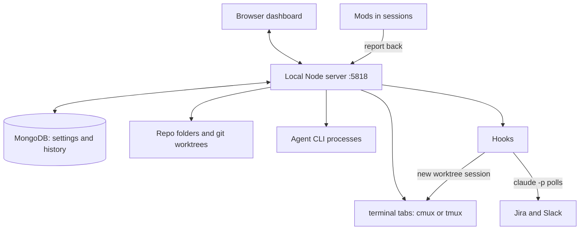
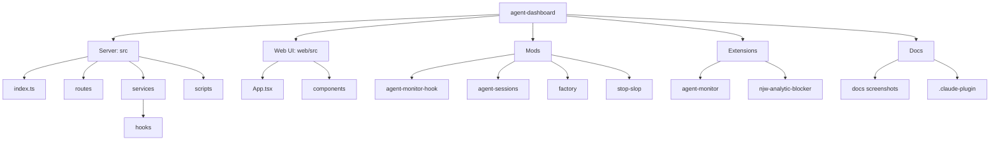
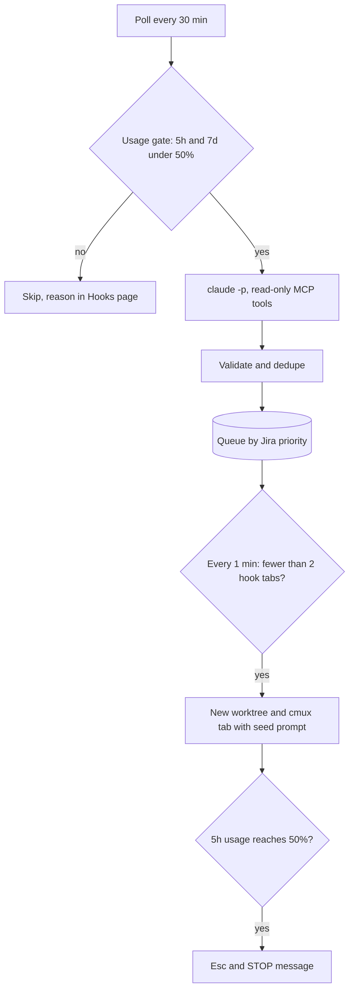

# Agent Dashboard - The one place to Visualise AI

Live dashboard of git worktrees, terminal tabs (cmux or tmux) and bare agent CLI processes (Claude Code, Copilot, Codex, etc.) across the repo folders you configure.


## How it fits together



## Set it up, step by step

### Step 1: Prerequisites

| Need | Required | Notes |
| --- | --- | --- |
| Node.js 20+ | yes | `@types/node` targets 20; no `engines` field is set |
| git | yes | worktree discovery |
| MongoDB | yes | settings and history (step 2) |
| gh | no | open-PR badges |
| cmux or tmux | no | tab listing, send, read and new sessions; without either, Terminal.app opens sessions only |
| Claude CLI | no | hooks run `claude -p` |

```bash
node -v && git --version
```

Expect Node 20 or newer.

### Step 2: Install MongoDB and run it as a service

| Platform | Commands |
| --- | --- |
| macOS | `brew tap mongodb/brew && brew install mongodb-community && brew services start mongodb/brew/mongodb-community` |
| Linux (generic) | install `mongodb-org` per the MongoDB docs, then `sudo systemctl enable --now mongod` |
| Docker (generic) | `docker run -d --name mongo -p 27017:27017 --restart unless-stopped mongo:7` |

You should see MongoDB listening on `127.0.0.1:27017`. The Setup page can also start the Homebrew service for you.

### Step 3: Clone and build

```bash
git clone https://github.com/snj-adhikari/agent-dashboard.git
cd agent-dashboard
npm install
npm run build   # web (Vite/React/Tailwind), then server (tsc)
```

You should see `dist/` and `web/dist/` created.

### Step 4: Configure

```bash
echo 'MONGO_URL=mongodb://127.0.0.1:27017' > .env
echo 'MONITOR_PORT=5818' >> .env
```

Both are the defaults, so this step is optional unless MongoDB or the port differs.

### Step 5: Start

```bash
npm start
```

While setup is incomplete or MongoDB is unreachable the console prints `Setup incomplete: open http://localhost:5818/setup`.

### Step 6: Run the onboarding wizard

Open http://localhost:5818. First run opens the wizard; re-run it any time from the Setup page.


| Step | What it sets | Required |
| --- | --- | --- |
| MongoDB | reachability check, install help | yes (later steps stay locked) |
| Repo folders | directories scanned one level deep for git repos | yes |
| Profile | display name, GitHub handle, PR skill names | no |
| Vault | notes folder; Vault page is hidden when unset | no |
| Atlassian + hooks | site, Repository field, work types, project-to-repo mappings, base-branch rules, usage-state file | no |
| LaunchAgent | generates and installs the service plist | no |
| Blocker sites | domains the Chrome blocker applies to | no |

Each step saves on its own.

### Step 7 (optional): Run as a macOS service

- In the wizard's LaunchAgent step: generate, then install (`launchctl bootstrap`); it can also remove it.
- Label defaults to `agent-monitor`; only env var names are stored in MongoDB, never values.
- Enable cmux socket access in the same step: it generates a token, shows the cmux settings snippet and writes the token to the plist as `CMUX_SOCKET_PASSWORD`.
- Without it a standalone service sees 0 cmux tabs (cmux only accepts its own child processes by default).

<details>
<summary>Manual cmux socket steps</summary>

1. Back up `~/.config/cmux/cmux.json`, then add an uncommented block and run `cmux reload-config`:
   ```jsonc
   {
     "automation": {
       "socketControlMode": "password",
       "socketPassword": "<random token, e.g. python3 -c \"import secrets; print(secrets.token_hex(24))\">"
     }
   }
   ```
2. In `~/Library/LaunchAgents/<label>.plist` add `cmux`, `git` and `gh` to `PATH` plus the same token:
   ```xml
   <key>EnvironmentVariables</key>
   <dict>
       <key>PATH</key>
       <string>/opt/homebrew/bin:/opt/homebrew/sbin:/usr/local/bin:/Applications/cmux.app/Contents/Resources/bin:/usr/bin:/bin:/usr/sbin:/sbin</string>
       <key>CMUX_SOCKET_PASSWORD</key>
       <string>same token as above</string>
   </dict>
   ```
3. Reload (`launchctl kickstart` does not pick up plist env changes):
   ```bash
   launchctl bootout gui/$(id -u)/<label>
   launchctl bootstrap gui/$(id -u) ~/Library/LaunchAgents/<label>.plist
   ```

`password` mode is the least-privileged option that still lets an external process connect; avoid `allowAll`, `openAccess` and `full`.

</details>

### Step 8 (optional): Install mods and Chrome extensions

Mods, either way:

```bash
/plugin install <name> --marketplace snj-adhikari/agent-dashboard
```

- Or open the Plugin page and click **Add to this device** (copies the mod to `~/.claude/skills/<name>`) or **Download** (zip).
- Chrome extensions: open `chrome://extensions`, enable Developer mode, **Load unpacked**, pick the extension folder.
- On the blocker card, **Add to this device** copies the extension, opens `chrome://extensions` and puts the folder path on the clipboard.


### Step 9: Verify

```bash
curl -s http://localhost:5818/api/graph | head -c 100
launchctl list | grep agent-monitor   # service only; use your label
```

- Home shows repos, worktrees, terminal tabs and agents.
- The curl prints JSON starting with a mermaid graph and state.
- Without MongoDB, `/api/history` errors but the rest still works.

## Project structure

```
agent-dashboard/
├── src/                          Node/TS server
│   ├── index.ts                  HTTP server, startup, settings load
│   ├── routes/                   HTTP API
│   ├── services/
│   │   ├── repos.ts              git worktree discovery
│   │   ├── processes.ts          agent process discovery
│   │   ├── terminal.ts           terminal backend: cmux, tmux or Terminal.app
│   │   ├── cmux*.ts              cmux tabs and control
│   │   ├── settings.ts           settings in MongoDB
│   │   ├── launchAgent.ts        macOS service plist
│   │   ├── vault.ts              notes vault
│   │   └── hooks/                Jira and Slack triggers
│   └── scripts/                  settings:import
├── web/src/                      React frontend
│   ├── App.tsx                   pages and navigation
│   └── components/               Home graph, Setup, wizard, Plugin, Vault
├── mods/                         Claude Code plugins
│   ├── agent-monitor-hook/       hook status line
│   ├── agent-sessions/           /agent-sessions tree
│   ├── factory/                  /factory agent team
│   └── stop-slop/                writing rules
├── extensions/                   Chrome extensions
│   ├── agent-monitor/            session popup
│   └── njw-analytic-blocker/     GTA - Blocker
├── docs/                         screenshots
├── .claude-plugin/               marketplace manifest
├── hooks.config.example.json     hooks config template
└── .env.example                  env template
```



## Terminal backends

Set `terminal` in Setup (Profile) or the `TERMINAL_BACKEND` env var to `auto`, `cmux`, `tmux` or `terminal`. Auto picks cmux if its CLI answers, else tmux if installed, else Terminal.app.

| Backend | List tabs | Send / read output | Open session |
| --- | --- | --- | --- |
| cmux | yes | yes | new workspace |
| tmux | sessions prefixed `ad-` | yes | detached session, plus a Terminal window on macOS when `terminalOpenWindow` is on |
| terminal (Terminal.app) | no (bare agent processes are still detected) | no | new window |

## Pages

| Page | Shows |
| --- | --- |
| Home | graph of repos, worktrees, tabs, agents; spawn or delete worktrees |
| History | MongoDB activity timeline (day, week, month) and session list |
| Vault | notes folder tree and graph (hidden until a vault path is set) |
| Hooks | poll, gate and queue state; start a ticket by key |
| Plugin | mods and extensions: download or add to this device |
| Setup | settings and the onboarding wizard |

Inactive worktrees collapse into one "+N inactive" node per repo on Home; click to expand. Bulk delete only removes worktrees that pass these rules:

| Rule | Outcome |
| --- | --- |
| main worktree | kept |
| open cmux tab or agent running inside it | kept |
| open PR | kept |
| files changed in the last hour | kept |
| merged or closed PR, or branch strictly behind the default branch | inactive |
| otherwise, no file changes for 5 days | inactive |

## Mods and extensions

| Name | What | Install |
| --- | --- | --- |
| `agent-sessions` | `/agent-sessions` prints every Claude session by repo and worktree | marketplace, or `claude --plugin-dir ./agent-sessions` from the Plugin zip |
| `agent-monitor-hook` | shows hook ticket and phase in the status line, reports to `/api/hook-session` | marketplace, or `claude plugin validate mods/agent-monitor-hook` |
| `stop-slop` | writing rules for replies and drafts (short bullets, no AI tells) plus an editing skill | marketplace, or `claude --plugin-dir ./mods/stop-slop` |
| `factory` | `/factory <goal>`: grills you one question at a time, then runs lead, researchers, planner, developers and QA unattended | marketplace, or `claude --plugin-dir ./mods/factory --model opus` |
| `extensions/njw-analytic-blocker` | Chrome extension (GTA - Blocker): blocks analytics and ad requests, strips click ids, hides tracking cookies on the sites you set | Load unpacked |
| `extensions/agent-monitor` | Chrome toolbar popup listing agent sessions by repo and worktree | Load unpacked |

- Mods read `AGENT_MONITOR_URL` (default `http://localhost:5818`).
- Factory commands: `/factory-show`, `/factory-report <lead session>`, `/factory-stop`. A Bash hook blocks `git commit` and `git push` unless your latest message asks.

## Hooks

`Trigger`s (`{ name, poll() }`) in `src/services/hooks/` auto-start work from Jira assignments and Slack PR-review requests.



| Hook | Picks up | Result |
| --- | --- | --- |
| `jira` | tickets assigned to you in the last 35 min, not Done: `Bug`, `Defect subtask`, `Dev subtask`, or a `Task` with "spike" in the summary (never Stories) | work: branch `fix/<key>`, then wait for approval or open a draft PR; spike: branch `tech/<key>`, read-only |
| `jira-mention-pr` | a Jira comment mentioning you with a GitHub PR link (allowed orgs, repo known from config), last 35 min | tab runs the same PR review command as `slack-pr-review`; skipped while a review is pending |
| `slack-pr-review` | "pr review please" plus a GitHub PR link, mentioning you or in a DM, last 35 min | tab runs your PR-review skill from the profile (or a plain review prompt), drafts a pending review only |

- Manual start: enter a ticket key in the Hooks page; skips the window, queue and gate, still deduped.
- Branch collisions get `-i`, `-ii` suffixes; base is `origin/HEAD` unless a `baseBranches` rule matches.
- Hook tabs are titled `[hook:<name>] <branch>`; closing one frees its slot.
- Ticket and Slack text never reaches the work session, only the validated key or PR URL.
- Polls use `claude -p --tools ""` with only read-only MCP tools allowed; MCP writes are refused.

Config: copy `hooks.config.example.json` to `hooks.config.json` (gitignored, re-read each cycle).

| Key | Purpose |
| --- | --- |
| project and Repository-field mappings | map tickets to repos (no fuzzy matching) |
| `baseBranches` | base-branch rules |
| `completion` | `approve` (default) or `draft-pr` |
| `maxConcurrent` | concurrent hook tabs |
| `pollModel` | model for polls |
| `allowedGithubOrgs` | optional PR URL allow-list |

- State (seen ids, queue, halted tabs) lives in `hooks-state.json`.
- Each poll is a real `claude -p` run, about $0.3 to $1 on Sonnet 5 (measured), up to 48 polls a day per hook while the gate is open. Lower `pollModel` or remove a hook from `HOOKS` to cut it.
- Add a hook: write one `Trigger` file and add it to `HOOKS`.

## Settings and env

Settings live in the MongoDB `settings` collection; env vars override them.

| Variable | Default | Purpose |
| --- | --- | --- |
| `MONITOR_PORT` | `5818` | HTTP port |
| `MONGO_URL` | `mongodb://127.0.0.1:27017` | MongoDB connection |
| `MONGO_DB` | `agent_monitor` | database name |
| `WATCH_DIRS` | saved list | comma-separated repo folders; replaces the saved list |
| `VAULT_PATH` | saved path | notes folder |
| `DISABLE_HOOKS` | unset | `1` disables hook polling |
| `CLAUDE_BIN` | `claude` on `PATH` | path to the Claude binary |
| `MONGO_SERVICE` | `mongodb-community` | Homebrew service the Setup guide starts |
| `TERMINAL_BACKEND` | `auto` | `cmux`, `tmux` or `terminal`; overrides the Setup choice |

## Migrating an existing install

`npm run settings:import -- <flags>` builds the server, then imports a `hooks.config.json` and LaunchAgent plist (names only) into settings. All flags are optional; set `MONGO_DB=<db>` to seed a copy first.

| Flag | Value |
| --- | --- |
| `--repo-dirs` | comma-separated repo folders |
| `--vault` | notes folder |
| `--plist` | LaunchAgent plist path |
| `--hooks-config` | `hooks.config.json` path |
| `--display-name`, `--github` | profile |
| `--create-pr-skill`, `--pr-review-skill` | skill names |
| `--atlassian-site`, `--repository-field` | Atlassian site and custom field id |
| `--work-types`, `--subtask-type` | comma-separated types, subtask type |
| `--usage-state` | usage-state file path |
| `--blocker-sites`, `--blocker-name` | blocker domains and name |
| `--extra-instructions-file` | extra hook instructions file |
| `--dry-run`, `--force` | boolean flags |

```bash
npm run settings:import -- --repo-dirs ~/code,~/projects --vault ~/notes --display-name "Your Name" --github your-handle
```

## Checks

| Script | Does |
| --- | --- |
| `npm run build` | web, then server |
| `npm run build:web` / `build:server` | one half only |
| `npm run dev` | build, then start |
| `npm run check` | build server, run `dist/check.js` |
| `npm run check:hooks` | hook validation, prompt hygiene, shell quoting |

## Security

- Binds to `127.0.0.1` only.
- Rejects foreign `Host` and `Origin` headers (LAN access, DNS rebinding).
- POSTs must be JSON (CSRF).
- Secrets are never stored in MongoDB; only env var names.
- Hook inputs are validated in code before reaching a session.

## Limitations

- No token usage or cost per session; the dashboard never fabricates these.
- "Switch to session" in History only works while the cmux tab is open.
- If the cmux daemon is down, only bare agent processes are shown.
