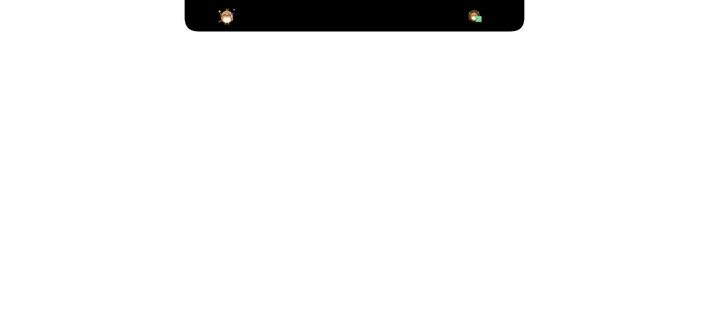
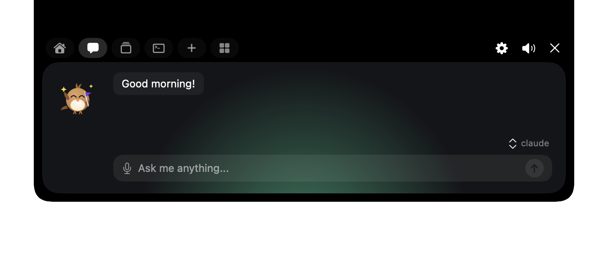
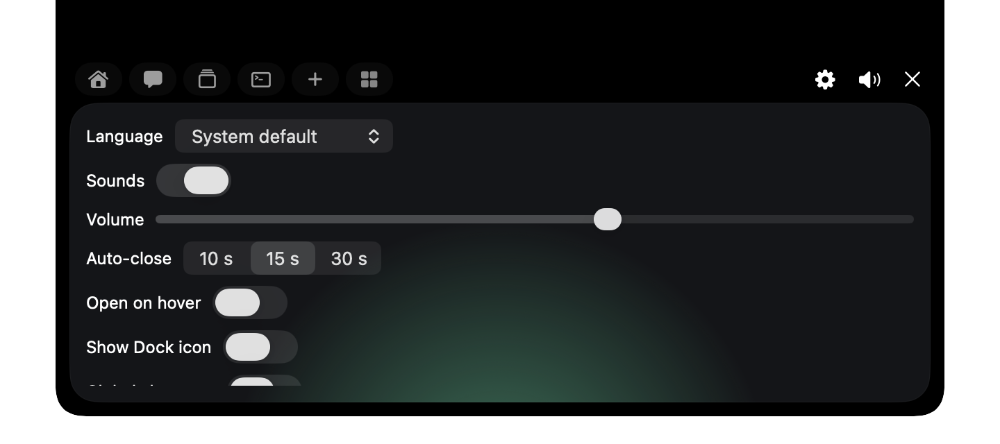
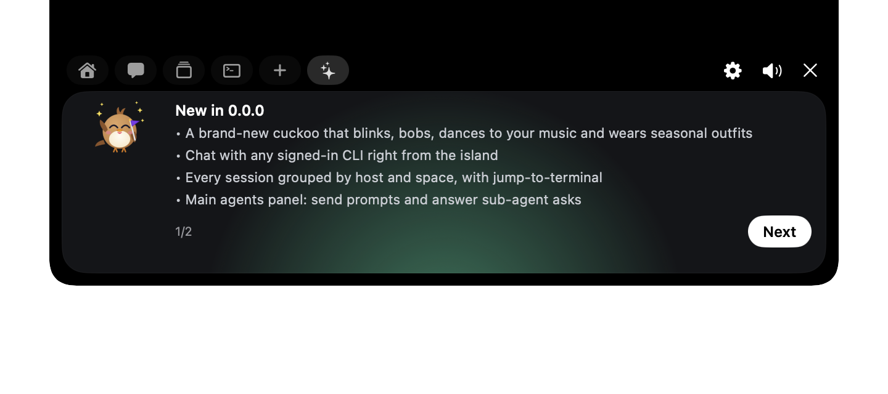
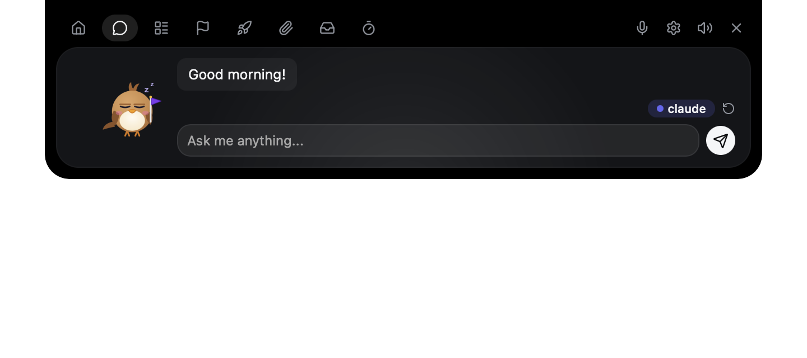
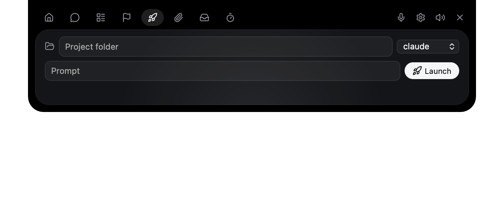

# agent-cuckoo

Inspired by [coucou](https://github.com/Louis-CFM/coucou) and built with the help of REA, [Reverse Engineer Anything](https://github.com/morluto/rea).

agent-cuckoo is a notch island for your coding agents. It reads every live agent from a running agent-monitor (herdr, Herdr app, cmux, tmux and bare sessions), with no per-agent hook to install. Main agents carry a ⚑ MAIN badge and sort first, and the rest are grouped by space.

The code here is written fresh; the name, mascot and icon are our own. Asset sources are listed in [ASSETS.md](ASSETS.md).

## What it does

- One pill per agent, showing its state, grouped by space with mains first.
- Super-agent panel: send a line to one main agent or to all mains, and see their `<codename> here: ...` replies.
- Approvals: answers Claude permission dialogs with a click. Commit and push grants stay in the terminal.
- Launcher: finds the agent CLIs installed on your machine (claude, copilot, gemini, codex, cursor-agent, opencode) and starts a new session in a folder you choose. Each CLI uses its own login; agent-cuckoo never reads credential files and needs no API key.

## Screenshots

### macOS

| Compact island | Chat greeting |
| --- | --- |
|  |  |
| **Settings** | **What's new** |
|  |  |

Desktop mascot: 

### Windows and Linux (Tauri)

| Compact island | Chat |
| --- | --- |
|  |  |
| **Launcher** | |
|  | |

## Platforms

| Platform | App | Download |
| --- | --- | --- |
| macOS 13+ (Apple silicon and Intel) | Native Swift app | `agent-cuckoo-<version>-macos-universal.dmg` |
| Windows 10/11 | Tauri app | `.exe` installer or `.msi` |
| Linux | Tauri app | `.AppImage` or `.deb` |

On Windows and Linux the island is read-only for agents the monitor can't send to.

## Install

1. Start agent-monitor (`npm start` in the agent-monitor repo); it listens on `http://127.0.0.1:5818` and writes its API token to `~/.config/agent-monitor/token`.
2. Download the build for your platform from the latest release.
3. Open it and allow the first launch (below).

### First launch on macOS (Gatekeeper)

Release builds are ad-hoc signed unless signing secrets were set, and they are never notarised, so macOS blocks the first open either way.

1. Open the .dmg and drag agent-cuckoo to Applications.
2. Right-click (or Control-click) agent-cuckoo in Applications and choose **Open**, then **Open** again.
3. If there is no Open button, go to System Settings > Privacy & Security and click **Open Anyway**.

Or from a terminal: `xattr -dr com.apple.quarantine /Applications/agent-cuckoo.app`.

### First launch on Windows (SmartScreen)

1. Run the installer. If "Windows protected your PC" appears, click **More info**.
2. Click **Run anyway**.

### Linux

- AppImage: `chmod +x agent-cuckoo*.AppImage` then run it.
- Debian/Ubuntu: `sudo apt install ./agent-cuckoo*.deb`.

## Build from source

```sh
CUCKOO_VERSION=0.1.0 bash apps/agent-cuckoo/scripts/build-macos.sh   # macOS .dmg
CUCKOO_VERSION=0.1.0 bash apps/agent-cuckoo/scripts/build-tauri.sh   # Tauri bundles
```

Output goes to `apps/agent-cuckoo/dist/`. Asset sources are listed in [ASSETS.md](ASSETS.md).

Author: Snj - nightwalker
