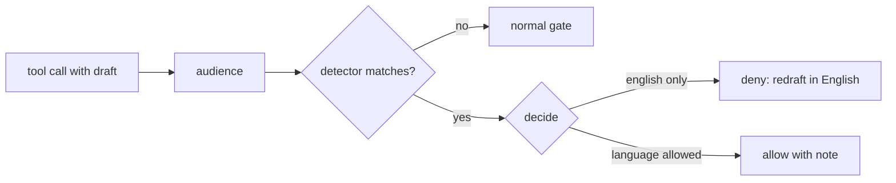

# Agent - That feels like you

Plugin id: `agent-more-like-you`. Learns how you write per audience and makes agents redraft external comments in that voice.

- Audiences: Slack DM, Slack channel, Jira, Confluence, GitHub PR.
- Learns from your typed prompts, sends, edits to agent drafts and an optional notes folder.
- Read-only on every external system; nothing is sent or posted.
- Generic language policy: English-only by default, per-language detectors opt in.

## Install

- Marketplace: `claude plugin install agent-more-like-you@agent-monitor`
- Local: `claude --plugin-dir ./mods/agent-more-like-you`

## Folder

Resolved once, first hit wins:

1. `MORE_LIKE_YOU_VAULT`: the folder itself.
2. `VAULT_PATH`: `<root>/more-like-you`.
3. Dashboard `settings.vaultPath` from `${AGENT_MONITOR_URL}/api/settings` (default `http://127.0.0.1:5818`): `<root>/more-like-you`. Best effort; errors fall through.
4. `~/.claude/more-like-you`.

It holds `config.json`, `style-profile.md`, `phrasebook.md`, `rules.md`, `perspective.md`, `changelog.md`, `cursor.json`, `languages.json`, `languages/` and `raw/`.

## config.json

Written by `/more-like-you learn` on first run. Missing keys use the default.

| Key | Default | Meaning |
| --- | --- | --- |
| `sources` | all `true` | `slack`, `jira`, `confluence`, `github`, `transcripts`, `notes`, `prompts` |
| `audiences` | all `true` | audiences the gate applies to |
| `backfillDays` | `90` | window for the first `learn` |
| `staleDays` | `7` | age before the nudge, and before a full refresh |
| `threshold` | `null` | override the learnt human threshold |
| `notesDir` | `null` | notes folder to learn from; falls back to the resolved vault root |
| `autoRefresh` | `local` | `local` or `full` |
| `judgeLimit` | `300` | max paragraphs judged per run |
| `perspective` | `true` | inject a `perspective.md` excerpt once per session |

## Hooks

| Event | What it does |
| --- | --- |
| `session.start` | Starts a local learn (no MCP, no model): typed prompts, captured prompts, feedback, observed rows, transcripts, notes; refreshes markers, `rules.md` and phrasebook counts. With `autoRefresh: full`, an existing `cursor.json` and stale cursors, may spawn one detached headless `/more-like-you refresh` in the session's permission mode (`default` when unknown); never in plan mode. Registers the `more_like_you` tool. |
| `prompt.submit` | Captures your cleaned, redacted typed prompt to `raw/`. Logs your next prompt after an allowed gated draft as feedback. Adds a one-line nudge once per session when the cursor is missing or stale. Once per session, when `perspective` is on and `perspective.md` exists, adds an excerpt of it (800 character cap) as context, framed: "How the user thinks and why. Use it to understand their reasoning and explain trade-offs in terms they care about. It is not evidence that they are right: judge each case on its merits, disagree when the facts point elsewhere, and do not agree just because something matches their past choices." |
| `tool.call` | Gate: the first write per audience per session (Slack draft, Jira or Confluence comment, `gh` PR comment or review) is denied with your rules, edits and profile section; the retry goes through. Never denies when there is nothing to apply. Passive capture: non-write tool results are run through `extractors.ts`; the result is never altered. |

## Language policy

Generic gate, no built-in language. Drafts in a language other than English are denied unless the audience is a direct chat whose every participant is allowed that language.

- Detection: one JSON file per language in `<folder>/languages/`. Any mod can supply one; [nepali-voice](../nepali-voice/README.md) is an example provider.
- No detector file, no deny: with nothing to detect, nothing is blocked.
- Allowed: Slack DM, or a group DM listed in `chats[]` (kind `dm` or `group-dm`, any channel id prefix), where every participant is in that language's `people` and none in `englishOnlyPeople`.
- Denied: everything else, with `English only for <audience>: redraft in English.`
- Allowed language DM: the draft goes through. Its note (language is fine in the user's spelling style; technical detail stays in English) is attached to the first-write gate deny only, so it shows only when that gate fires.
- Participants come from `chats[].people`, else (1:1 DM only) the `U` user id, or for a `D` channel the single captured other author, else unknown (English).
- Also covers `gh pr create/edit --body`, `gh issue comment`, Confluence page create/update, Jira create/edit and Slack canvases.
- `englishOnly` containing `slack-dm` blocks both DMs and listed group DMs; `slack-channel` does not block a listed group DM. Unlisted channels are never direct, except 1:1 DMs (`D` or `U` ids).
- Reads `languages.json` and the detector files from the folder each call. A missing or malformed `languages.json` means English everywhere, but detectors still load, so the deny still fires.



### languages.json

Optional, in the folder. Missing keys use the default.

| Key | Meaning |
| --- | --- |
| `languages` | map of language id to `{ "label", "people", "detect"? }`; inline `detect` wins over a detector file with the same id; `label` falls back to the detector file's `label`, then the id |
| `englishOnly` | audiences forced English; only `slack-dm` has an effect (see above): `jira`, `confluence`, `github-pr`, `slack-channel`, `slack-dm` |
| `englishOnlyPeople` | people who always get English; overrides every language |
| `chats` | `{ "channel", "kind": "dm" or "group-dm", "people": [...] }` entries; names or ids matched to a `people` entry by `name` or `slackId`; no match counts as unlisted |
| `nepaliPeople` | legacy alias, merged into `languages["ne-roman"].people` |

```json
{
  "englishOnly": ["jira", "confluence", "github-pr", "slack-channel"],
  "languages": {
    "es-informal": { "label": "Informal Spanish", "people": [{ "slackId": "U0TEST1" }, "U0TEST2"] }
  },
  "englishOnlyPeople": [{ "slackId": "U0TEST3" }],
  "chats": [{ "channel": "C0TEST5", "kind": "group-dm", "people": ["U0TEST1", "U0TEST2"] }]
}
```

People entries may also be plain id strings.

### Detector files

`<folder>/languages/<id>.json`:

```json
{ "id": "es-informal", "label": "Informal Spanish",
  "detect": { "scripts": [], "sure": ["vale", "oye", "gracias", "porque"], "maybe": ["que", "el", "la"], "minHits": 2,
              "normalise": [] },
  "learnt": "raw/{date}-es-learnt.jsonl" }
```

| Key | Meaning |
| --- | --- |
| `id` | language id; defaults to the filename stem |
| `label` | name shown in the allow note |
| `detect.scripts` | hex codepoint range pairs; any character in a range is a match |
| `detect.sure` | unambiguous words; at least one hit is needed for a word match |
| `detect.maybe` | ambiguous words; count towards `minHits` only |
| `detect.minHits` | distinct hits needed for a word match (default 2) |
| `detect.normalise` | ordered literal replacements applied after lowercasing |
| `learnt` | optional staging file template inside the folder, `{date}` is `YYYY-MM-DD`; read only by the refresh skill (not the hooks), which skips it when absolute or containing `..` |

- Match: any character in a script range, or at least one `sure` hit and distinct hits of at least `minHits`.
- Word matches ignore code fences, inline code, URLs, paths and camelCase; script matches scan the whole text.
- Each file is parsed on its own; a bad file drops only that language. Size caps apply (files, words, word length, ranges).
- If one person is in several languages, the first by sorted id wins.

The `more_like_you` tool has actions `ingest`, `queue`, `label`, `samples` and `eval`.

## Usage

- `/more-like-you learn` the first time: asks the config questions, pulls, ingests, judges, evals, spot-checks with you, then writes the profile.
- `/more-like-you refresh` when nudged.

The refresh decision runs on `classic.SessionStart`, which carries the session's `permission_mode`. Full mode reads `~/.claude/usage-state.json`, which is not a standard Claude Code file. When it is missing or stale, the spawn is skipped and the session shows the refresh nudge instead.

## Custom pull files

Any `raw/<date>-<name>-pull.jsonl` is ingested, one JSON object per line:

```json
{"id":"example:1","source":"example","ts":"2026-01-15T09:30:00Z","text":"short sample message","self":true,"audience":"slack-channel","target":"example-thread-1"}
```

- `self: true` marks your own text without an identity lookup.
- `audience` (one of the five) puts it in that profile section; without it the row feeds markers and phrasebook only.
- `target` is the match key against agent writes to the same place.

To capture a new tool-result shape automatically, add an extractor to `hooks/extractors.ts` (`{ name, test, extract }`).

## Privacy

Everything stays in the local folder. Captured prompts pass through redaction first: key-prefixed tokens, JWTs, `Bearer` tokens, `key=value` secrets and long hex or base64 runs become `[redacted]`. Only text that passes the classifier as yours feeds the profile; others' text is reference only. Your CLAUDE.md, rules files and hooks, then the stop-slop bans, then your explicit instructions outrank the profile, including any formatting rules (layout, bullets, line breaks, length).

## Structure

The built-in scorer is neutral on layout: bullets, line count and multi-line messages neither raise nor lower a score. The only structural AI tell is a wall of 3 or more bullets mostly made of ticket or PR ids. Layout is learnt per audience as `structure` markers in `phrasebook.md`, from that audience's own human sends and feedback rewrites. Typed prompts feed vocabulary and phrasing markers only, never structure.
