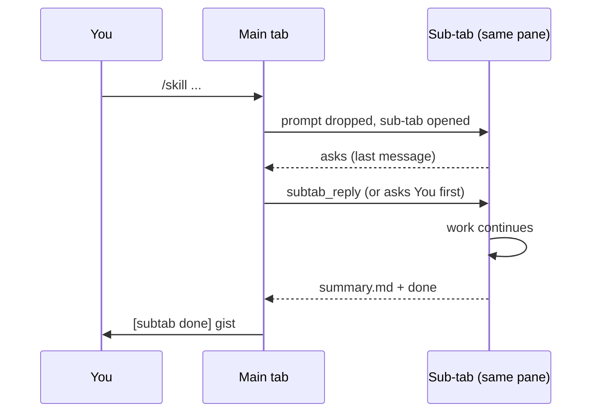

# Agent Magic - Every skill gets its own tab

Runs each typed skill in its own sub-tab (a cmux tab in the same pane, a herdr tab in the same session, or a Herdr app tab in the same space), relays its questions and done-summary into the main tab, and lets the main agent answer or finish it.

Plugin id: `agent-orchestration`.

## Install

- Marketplace: `claude plugin install agent-orchestration@agent-monitor`
- Local: `claude --plugin-dir ./mods/agent-orchestration`
- Needs `claude` on `PATH` plus the host: [cmux](https://cmux.dev), [herdr](https://herdr.dev) inside herdr, or the Herdr desktop app's `hc` and `herdr-app` inside a Herdr app terminal. Outside all three (no `CMUX_SURFACE_ID`, `HERDR_PANE_ID` or `HC_TERMINAL_ID`) the mod does nothing.

## How it works

- Typing `/<skill> ...` in a cmux tab drops the prompt, opens a sub-tab in the same pane running `claude --permission-mode <mode> "/<skill> ..."`, and clears the input box. `<mode>` is the main tab's mode, else `AGENT_SUBTAB_MODE` (e.g. `auto`), else `default`.
- Inside herdr (`HERDR_ENV=1`) the sub-tab is `herdr tab create --label /<skill>` in the caller's workspace with `AGENT_SUBTAB_ID` set, then `herdr agent start sub-<id> --kind claude` and the typed prompt through `herdr agent prompt`. If the agent fails to start, the tab is closed, the run dropped and a notification sent. Replies go through `herdr agent prompt`, finished tabs close with `herdr tab close`, and notifications still use `cmux notify`. The main tab is keyed by `<HERDR_SESSION>:<HERDR_PANE_ID>` there (pane ids repeat across sessions), `CMUX_SURFACE_ID` elsewhere, and every herdr call for a run targets that run's session.
- Inside a Herdr app terminal (`HC_TERMINAL_ID` set, no `HERDR_ENV`) the sub-tab is `hc run --bg --no-parent --name sub-<id> --label herdr.space=<caller's space> --label herdr.tab=sub-<id> -- env AGENT_SUBTAB_ID=<id> claude --permission-mode <mode> "/<skill> ..."`, so it shows as a new tab in the caller's space, renamed `/<skill>` with `herdr-app do tab.rename`. Replies go through `hc send`, finished runs end with `hc kill` + `hc rm`, and liveness comes from `hc ls`. The main tab is keyed by `hc:<HC_TERMINAL_ID>`. herdr wins when both are set. `cmux notify` is best effort there.
- `<mode>` is the main tab's permission mode, captured into `~/.claude/agent-orchestration/mode-<surface>.json`; `default` when unknown.
- A sub-tab question reaches the main tab as `[subtab <surface> <skill> asks]` plus its last message. The main agent answers with `subtab_reply`, which types `[subtab <id> reply] <text>` into the sub-tab (every relayed text starts with a `[subtab` tag so gates can tell it from a human prompt), or asks you first for judgement calls and anything that publishes, posts or merges. A question with choices (a review verdict, which comments to drop) is put to you as AskUserQuestion with the sub-tab's recommended option first. A commit, push or PR request is put to you as one AskUserQuestion (recommended option first, e.g. "Approve commit + push + create PR", "Commit only", "Deny"); with `AGENT_SUBTAB_APPROVER` set, the main agent runs that helper after your pick and before replying.
- When the skill finishes, the sub-tab writes `summary.md`, creates `done` and closes. The main tab gets `[subtab done]` with the summary.
- Sub-tab turns ending on a control line (`FACTORY: CONTINUE` or `FACTORY: WAIT`) keep running on their own and are not relayed. See the factory README for driving `/factory` this way.

## Main agent

- Tell any tab "you are the main agent" (or "claim main", "be main") and it becomes the main agent of its workspace: the Herdr app space, herdr workspace or cmux workspace. You then talk only to that tab.
- If another live tab already holds it, the agent asks you whether to switch first. On yes it calls `agent_main` claim, and the old main tab is told it no longer steers. A claim held by a closed tab is taken over without asking. "Release main" gives it up.
- Every 10 s the main tab checks the other terminals in its workspace and relays `[agents]` lines when one blocks, finishes a turn or closes. Sub-tab runs are left to the sub-tab relay.
- Any prompt to the main tab that mentions "agent" or "agents" gets a live status table.
- The main agent steers with `agent_send`: text is typed into the target tab tagged `[main <id>]`, and `close: true` ends it.
- It validates an agent's work before calling it done. It sends the commit, push or PR step only when you already asked for it in the session, and runs `AGENT_SUBTAB_APPROVER` first so your commit/push gate allows it. Merges, external posts and protected branches always go back to you.
- Claims live in `~/.claude/agent-orchestration/main/<scope>.json`. Herdr status comes from `hc ls` / `herdr agent list`. cmux has no agent status, so there only closed tabs are relayed.

## Hooks

Registered in `hooks/register.ts`, tested by `hooks/register.test.ts`.

| Event | What it does |
| --- | --- |
| `prompt.submit` (main tab) | A typed skill (not a built-in, not in the stay list) is dropped and opened in a sub-tab, unless the guard refuses; the box is cleared. |
| `prompt.submit` (sub-tab) | Adds the handoff instructions: summary to `summary.md`, then create `done`; questions as plain text, never AskUserQuestion. |
| `prompt.submit` (relayed) | Adds context telling the main agent how to answer, when to ask you, and when to finish. |
| `session.start` (main tab) | Registers `subtab_reply` and polls every 3 s: relays questions and summaries, closes finished sub-tabs, cleans up tabs closed by hand, notifies once after 12 h without a handoff. |
| `classic.UserPromptSubmit` (main tab) | Records the permission mode for new sub-tabs. |
| `turn.complete` (sub-tab) | Files the sub-tab's last message as a question for the main tab. |
| `prompt.submit` (main candidate) | Claims or releases main (asks first when another live tab holds it), and adds the agent status table when the prompt mentions agents. |
| `session.start` (watch) | Every 10 s, if this tab holds the claim, relays agents that blocked, finished or closed; tells a tab that lost the claim. |
| `tool.call` Bash | Refuses `cmux close-surface` / `close-workspace`, `herdr tab close` / `pane close` and `hc kill` / `rm` while a sub-tab run is live, so the summary is never skipped. |

## Skills

None defined. Any user-invocable skill typed in the main tab is routed, except the stay list below.

## Agents

None.

## Tool

| Tool | Parameters | Does |
| --- | --- | --- |
| `subtab_reply` (`mcp__agent-orchestration__subtab_reply`) | `surface` (id from the relayed prompt), `text` (the answer), `finish` (`true` to make the sub-tab write its summary and close) | Sends the answer or the finish request into the sub-tab. |
| `agent_send` (`mcp__agent-orchestration__agent_send`) | `target` (id or name), `text`, `close` | Main agent only: types a `[main <id>]` message into another tab in the workspace, or closes it. |
| `agent_main` (`mcp__agent-orchestration__agent_main`) | `action` (`claim` or `release`) | Takes the main-agent claim (after the user agreed to switch) or gives it up. |

## Settings

| Variable | Default | Does |
| --- | --- | --- |
| `AGENT_SUBTAB_OFF` | unset | `1` turns routing off; skills run in the main tab |
| `AGENT_SUBTAB_STAY` | unset | Comma-separated skill names that always run in the main tab, on top of `loop`, `update-config`, `keybindings-help`, `fewer-permission-prompts`. A trailing `*` matches a prefix (`ponytail*`) |
| `AGENT_SUBTAB_GUARD` | unset | Command run before opening a sub-tab (split on spaces, no shell). Non-zero exit drops the prompt with the command's stdout as the reason |
| `AGENT_SUBTAB_NAMER` | unset | herdr and Herdr app. Command run as `<command> <HERDR_SESSION or hc> --seed <run id>`, printing `{"codename": "..."}`. The agent (or hc terminal name) becomes `sub-<codename>`, the tab `/<skill> · <codename>`, and in herdr the pane reports it with `herdr pane report-metadata --display-agent <codename> --token codename=<codename>` |
| `AGENT_SUBTAB_APPROVER` | unset | herdr and Herdr app. Command the main agent runs after you approve a sub-tab's (or a steered agent's) commit, push or PR, as `<command> <HERDR_SESSION or hc> <sub-tab pane or hc terminal id> <kinds> [branch]` (kinds joined with `+`, e.g. `commit+push+pr`), before replying. Use it to issue a one-shot grant your own commit/push gate honours, since relayed replies don't count as your words |
| `AGENT_SUBTAB_SHOW` | unset | herdr only. Command run after the agent starts as `<command> <HERDR_SESSION> <agent name> --title "/<skill> · <codename>"`, e.g. to show the agent in a cmux tab. Failures go to the debug log |

Set them in the `env` block of `~/.claude/settings.json`. Run state lives in `~/.claude/agent-orchestration/runs/<id>/` and is removed when a run finishes.
