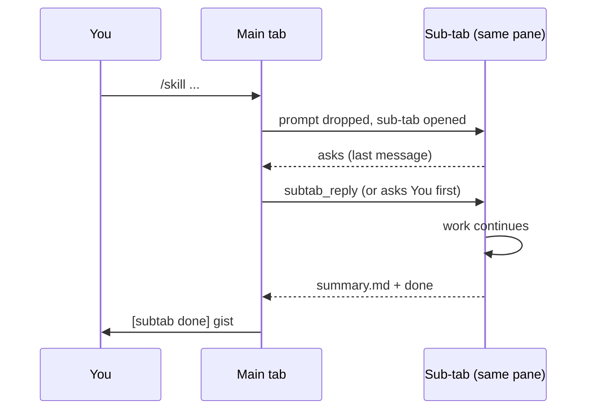

# Agent Magic - Every skill gets its own tab

Runs each typed skill in its own cmux sub-tab of the same pane, relays its questions and done-summary into the main tab, and lets the main agent answer or finish it.

Plugin id: `agent-orchestration`.

## Install

- Marketplace: `claude plugin install agent-orchestration@agent-monitor`
- Local: `claude --plugin-dir ./mods/agent-orchestration`
- Needs [cmux](https://cmux.dev) and `claude` on `PATH`. Outside cmux (no `CMUX_SURFACE_ID`) the mod does nothing.

## How it works

- Typing `/<skill> ...` in a cmux tab drops the prompt, opens a sub-tab in the same pane running `claude --permission-mode <mode> "/<skill> ..."`, and clears the input box.
- `<mode>` is the main tab's permission mode, captured into `~/.claude/agent-orchestration/mode-<surface>.json`; `default` when unknown.
- A sub-tab question reaches the main tab as `[subtab <surface> <skill> asks]` plus its last message. The main agent answers with `subtab_reply`, or asks you first for judgement calls and anything that publishes, posts, commits, pushes or merges.
- When the skill finishes, the sub-tab writes `summary.md`, creates `done` and closes. The main tab gets `[subtab done]` with the summary.
- Sub-tab turns ending on a control line (`FACTORY: CONTINUE` or `FACTORY: WAIT`) keep running on their own and are not relayed. See the factory README for driving `/factory` this way.

## Hooks

Registered in `hooks/register.ts`, tested by `hooks/register.test.ts`.

| Event | What it does |
| --- | --- |
| `prompt.submit` (main tab) | A typed skill (not a built-in, not in the stay list) is dropped and opened in a sub-tab; the box is cleared. |
| `prompt.submit` (sub-tab) | Adds the handoff instructions: summary to `summary.md`, then create `done`; questions as plain text, never AskUserQuestion. |
| `prompt.submit` (relayed) | Adds context telling the main agent how to answer, when to ask you, and when to finish. |
| `session.start` (main tab) | Registers `subtab_reply` and polls every 3 s: relays questions and summaries, closes finished sub-tabs, cleans up tabs closed by hand, notifies once after 12 h without a handoff. |
| `classic.UserPromptSubmit` (main tab) | Records the permission mode for new sub-tabs. |
| `turn.complete` (sub-tab) | Files the sub-tab's last message as a question for the main tab. |
| `tool.call` Bash | Refuses `cmux close-surface` / `close-workspace` while a sub-tab run is live, so the summary is never skipped. |

## Skills

None defined. Any user-invocable skill typed in the main tab is routed, except the stay list below.

## Agents

None.

## Tool

| Tool | Parameters | Does |
| --- | --- | --- |
| `subtab_reply` (`mcp__agent-orchestration__subtab_reply`) | `surface` (id from the relayed prompt), `text` (the answer), `finish` (`true` to make the sub-tab write its summary and close) | Sends the answer or the finish request into the sub-tab. |

## Settings

| Variable | Default | Does |
| --- | --- | --- |
| `AGENT_SUBTAB_OFF` | unset | `1` turns routing off; skills run in the main tab |
| `AGENT_SUBTAB_STAY` | unset | Comma-separated skill names that always run in the main tab, on top of `loop`, `update-config`, `keybindings-help`, `fewer-permission-prompts` |

Set them in the `env` block of `~/.claude/settings.json`. Run state lives in `~/.claude/agent-orchestration/runs/<id>/` and is removed when a run finishes.
