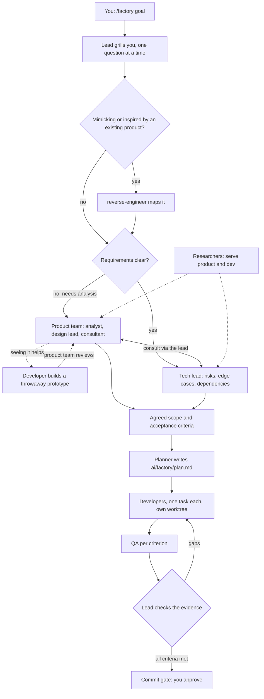
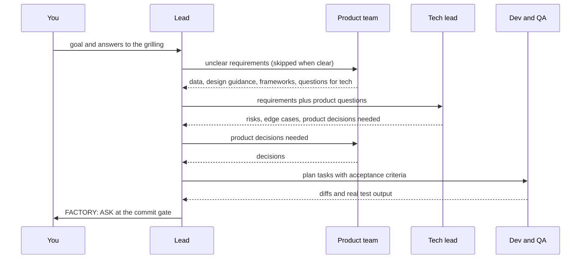
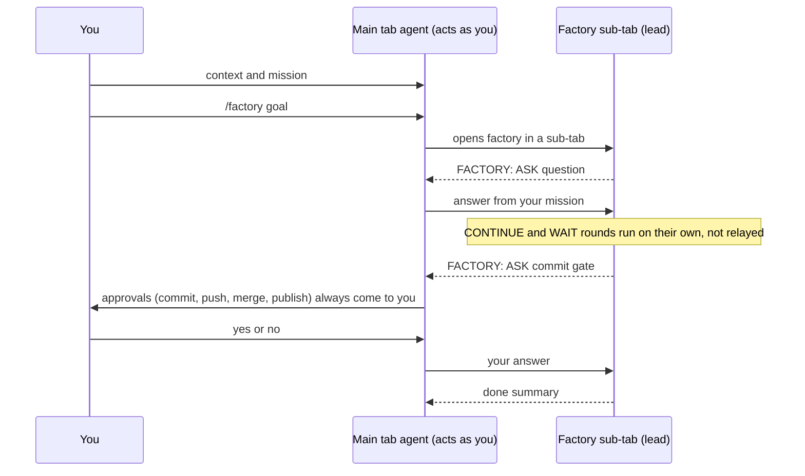

# Factory - The AI delivery team

`/factory <goal>` runs a lead agent that grills you, then drives product, tech lead, research, plan, dev and QA agents until every acceptance criterion has evidence.

Plugin id: `factory`.

- With clear requirements, the tech lead and dev team deliver without the product team.
- The product team (only when requirements are unclear) can shape a throwaway prototype with a developer, or analyse the product.
- Product and tech lead consult each other through the lead. Researchers serve both.

## Install

- Marketplace: `claude plugin install factory@agent-monitor`
- Local: `claude --plugin-dir ./mods/factory --model opus` (the lead is meant to run on Opus)
- `factory:reverse-engineer` uses the REA MCP tools and the reverse-engineer-anything skill when installed; otherwise it reads public docs and observes the product in a browser.

## Commands

| Command | What it does |
| --- | --- |
| `/factory [--brief <path>] [--no-herdr] <goal or ticket key>` | Starts a run: prints the agent map and sends the lead brief. Flags go anywhere; with `--brief` the goal may be left out and is taken from the brief's first heading or line. |
| `/factory-show` | Agent map, current round and live `factory:*` agents. |
| `/factory-report <session name \| off>` | Sends ASK, DONE and stop updates to another (lead) session, which answers the lead's questions (see below). No argument shows the current target. |
| `/factory-stop` | Ends the run. |

## Agents

| Agent | Model | What it does |
| --- | --- | --- |
| `factory:product-analyst` | Sonnet | Product team, only when requirements are unclear: reads the requirements and gathers the data to prioritise the idea. Read-only. |
| `factory:design-lead` | Sonnet | Product team, only when requirements are unclear: design guidance from the project's own design system. Read-only. |
| `factory:product-consultant` | Opus | Product team, only when requirements are unclear: applies product frameworks (JTBD, RICE, Kano), alternatives, riskiest assumption. Read-only. |
| `factory:tech-lead` | Opus | Every run: technical issues, risks, dependencies and edge cases in the requirements, before planning. Read-only. |
| `factory:researcher` | Sonnet (lead may pick Haiku or Opus) | Read-only research for both the product team and the dev team: code, tickets, docs, logs, market. |
| `factory:reverse-engineer` | Sonnet | When the goal mimics or takes inspiration from an existing product: maps how it works (structure, behaviour, data flow, network calls) for both the product team and the tech lead. Read-only, only targets you own or may study. |
| `factory:planner` | Opus | Writes `ai/factory/plan.md`: acceptance criteria checklist, independent tasks, test plan. |
| `factory:developer` | Sonnet | Implements one plan task, runs typecheck and unit tests. Never commits. |
| `factory:qa` | Sonnet | Runs tests, lint, typecheck and a browser check on dev or staging; pass or fail per criterion. Never edits source. |

## How it works

The lead runs the team like a delivery lead in a real company: product owns what and why, the tech lead owns how, researchers and the reverse-engineer serve both, and the lead coordinates and verifies.



### How the lead guides the team

Subagents cannot message each other, so every hand-off goes through the lead. Product and tech lead questions are relayed at most twice before scope is fixed; you are asked again only if the answers change scope.



- Each reply from the lead ends with one control line: `CONTINUE`, `WAIT`, `ASK` or `DONE`. The hooks below act on it.
- The lead runs on Opus and keeps every decision. Agents pick their model per task: Haiku for small lookups or mechanical changes, Sonnet for normal work, Opus for planning and judgement.

### Starting from a brief (`--brief`)

`/factory --brief ai/factory/brief.md` makes the lead read the brief before anything else.

- The grill step lists only what the brief leaves open (scope, acceptance criteria, repo, branch, environments, done, out of scope), one question at a time.
- A complete brief means no questions: the lead restates scope and acceptance criteria and goes straight to research, plan, dev and QA.
- A relative path is read from the session's folder. An unreadable brief stops the command before anything starts.

### Who answers the lead's questions

- With a report target set (`/factory-report <session>`), `ASK` turns go to that session, tagged `[relay factory] factory "<goal>": ASK ...` so they never count as your approval there. It answers from the brief and its own context, and asks you only when unsure.
- Always yours, never answered by the report target: scope changes, the commit gate, push or PR, and anything posted externally. The lead marks these `HUMAN ONLY:` and the report target passes them on verbatim.
- Prompts that start with `[relay ...]`, `[monitor]` or `[subtab ...]` never count as your approval for the git guard.

### Developers in herdr tabs (default inside herdr)

When the session runs inside herdr (`HERDR_ENV=1` with `HERDR_SESSION` set) developers open as visible herdr tabs instead of subagents. `--no-herdr` opts out; outside herdr the Agent-tool developers are used as before.

- The lead first checks `herdr session list` shows the session as running, else falls back to subagents.
- Per dev task: `snj-mem-guard.sh check` (queue when free RAM is below 12%), `git worktree add` branched from the ticket branch (`<ticket-branch>-dev<n>`, worktree `<ticket worktree>-dev<n>`), the task brief written to `ai/factory/task.md` in that worktree, `herdr tab create --env FACTORY_DEV=1` titled `<KEY> · <codename> · dev <n> · <task>`, `herdr agent start <key-lower>-<codename> --kind claude` with no prompt, then the fixed prompt `[relay factory-lead] Read ai/factory/task.md and do it.`
- The lead never puts brief text in a shell command: follow-ups are appended to `task.md` and announced with a fixed prompt.
- `FACTORY_DEV=1` makes this mod deny every `git commit` and `git push` in a developer session.
- Each developer tab gets its own codename and colour from `snj-term codename <session> --seed <KEY>-dev<n>`, shown in the herdr sidebar via `herdr pane report-metadata --display-agent <codename> --token codename=<codename>`. Without `snj-term` the agent is named `<key-lower>-dev<n>`.
- Developer agents live in herdr only; watch one with `herdr agent attach <name>` when needed.
- At most 4 developer tabs per ticket at once; the rest queue.
- The lead tracks tabs with `herdr agent wait --until idle --until blocked` and `herdr agent read`. Every prompt it types into another session starts with `[relay factory-lead]`.
- QA stays a `factory:qa` subagent. After QA passes the lead copies each developer's working-tree changes into the ticket worktree and closes the tab. Developer worktrees stay for you to clear.

### Driving factory from agent-orchestration

With the `agent-orchestration` mod, an agent can drive factory for you. Give the main tab your context and mission (the goal, constraints, what done means), then type `/factory <goal>`. Factory opens in a sub-tab; the main tab's agent answers the lead's grilling as you would, from that mission.



- Turns ending `FACTORY: CONTINUE` or `FACTORY: WAIT` stay in the sub-tab; `ASK` and `DONE` turns reach the main tab.
- Judgement calls the mission does not settle, and every commit, push, merge or publish approval, go to you.

## Hooks

Registered in `hooks/register.ts`.

| Event | What it does |
| --- | --- |
| `turn.complete` | Reads the lead's last line: `FACTORY: CONTINUE` starts the next round, `WAIT` waits for background agents, `ASK` notifies you, `DONE` ends the run. Stops after 30 rounds. With a report target, `ASK` is tagged human-only when the lead wrote `HUMAN ONLY:`. |
| `prompt.submit` | Records your latest message for the git gate; relayed prompts (`[relay ...]`, `[monitor]`, `[subtab ...]`) clear it instead. |
| `tool.call` Bash | During a run, denies `git commit` and `git push` unless your latest message says commit or push without a negation ("don't", "do not", "never", "no", "without", "not yet" a few words before). In a developer session (`FACTORY_DEV=1`) always denies them. |

## Skills

None.

## Settings

None. The round cap is fixed at 30 (`MAX_ROUNDS` in `hooks/register.ts`).

## Usage

```
/factory add dark mode to the settings page
/factory --brief ai/factory/brief.md
/factory --no-herdr --brief ai/factory/brief.md MC-1234 dark mode
```

- Answer the lead's questions until it restates scope and criteria, then it runs on its own until the commit gate.
