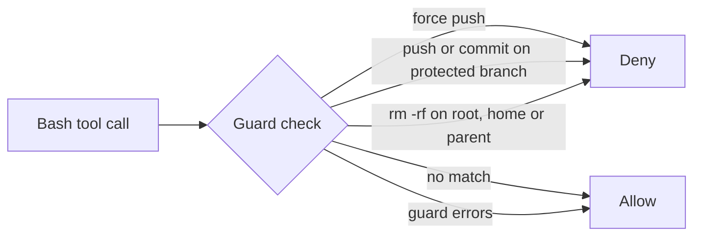

# Guards - No force pushes, no surprises

Blocks risky shell commands before they run: force pushes, commits or pushes on protected branches, and `rm -rf` on the root, home or parent folder.

Plugin id: `guards`.

## Install

- Marketplace: `claude plugin install guards@agent-monitor`
- Local: `claude --plugin-dir ./mods/guards`
- Needs `git`.

## Hooks

Registered in `hooks/register.ts`; rules in `hooks/rules.ts`, tested by `hooks/rules.test.ts`. If the guard itself errors, the command is allowed.

| Event | Blocks |
| --- | --- |
| `tool.call` Bash | `git push` with `--force`, `--force-with-lease`, `-f` or a `+ref` |
| `tool.call` Bash | `git push` to a protected branch, named (`origin main`, `HEAD:main`) or the current branch when none is named |
| `tool.call` Bash | `git commit` on a protected branch (a leading `cd <dir> &&` sets the folder checked) |
| `tool.call` Bash | `rm -rf` (flag forms `-rf`, `-fr`, `-r -f`, `-f -r`, `--recursive --force`) on `/`, `/*`, `~`, `~/*`, `$HOME`, `.` or `..` |

## Flow

## Settings

| Variable | Default | Used by |
| --- | --- | --- |
| `GUARDS_PROTECTED_BRANCHES` | `main,master,develop,staging` | protected branch checks (comma-separated) |

Set it in the `env` block of `~/.claude/settings.json`. The `setup-guards` skill in `dev-kit` installs this mod and adds extra rules.
